# FinSight — Enterprise Expense, Budget Management & Spend Intelligence Platform

<p align="center">
  
  
  
  
  
  
  
  
</p>

---

## Executive Overview

FinSight is an enterprise-grade financial management, multi-tier expense adjudication, budget allocation, and spend intelligence platform. Built with NestJS 11, TypeORM, PostgreSQL 16, and React 19 with Tailwind CSS v4, FinSight bridges the gap between daily employee operational expenditure and strategic corporate financial governance.

The platform implements Model B Dual-Stream Accounting, strictly segregating departmental operational expenses (OpEx) from project capital investments (CapEx). It guarantees zero double-counting, enforces approved-only spending semantics, provides real-time budget overrun detection, and pairs native Recharts analytical dashboards with live Microsoft Power BI embedded workspaces.

<p align="center">
  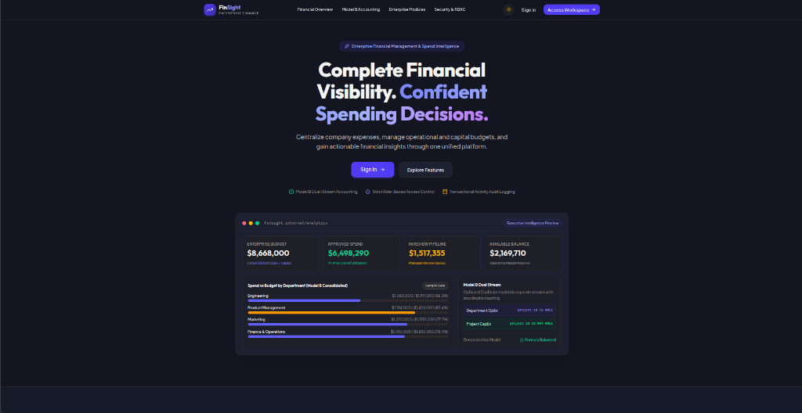
</p>

---

## Core Accounting Engine: Model B Dual-Stream Accounting

At the core of FinSight is Model B Dual-Stream Accounting, an enterprise financial model designed to ring-fence operational budgets while providing full capital investment visibility:

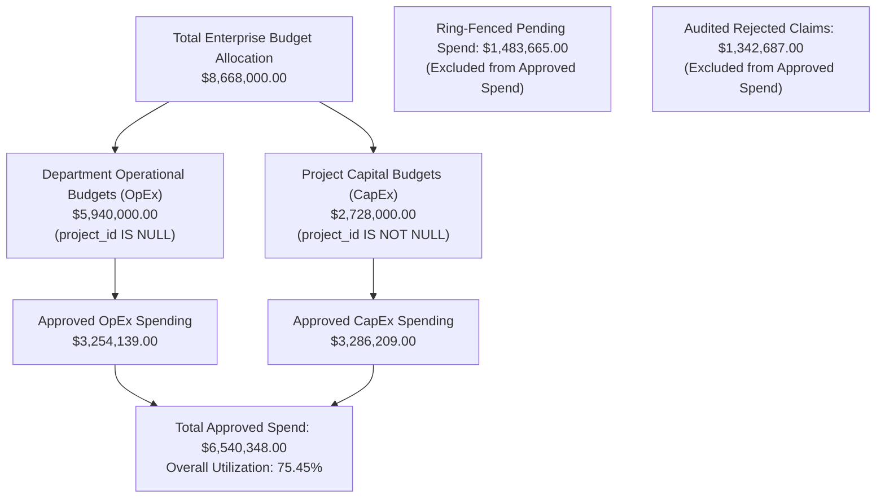

### Core Financial Invariants
1. Department Operational Stream (OpEx):
   - Covers day-to-day department overheads (`project_id IS NULL`).
   - Charged strictly against the department's authorized annual operational budget.
2. Project Capital Stream (CapEx):
   - Dedicated capital allocations tied directly to strategic projects (`project_id IS NOT NULL`).
   - Ring-fenced so project expenditures never silently drain departmental operational funds.
3. Consolidated Single-Counting:
   - Total Budget = OpEx Budget + CapEx Budget = $5,940,000 + $2,728,000 = $8,668,000.00.
   - Total Approved Spend = OpEx Spend + CapEx Spend = $3,254,139 + $3,286,209 = $6,540,348.00.
   - Verified across the baseline database, unit tests, E2E browser tests, and 1,000,000-record benchmark queries with $0.00 delta.
4. Approved-Only Spending Semantics:
   - PENDING claims ($1,483,665.00) and REJECTED claims ($1,342,687.00) are strictly ring-fenced and never counted toward budget consumption or utilization percentages.
5. No Proration Distortion:
   - Removed artificial daily linear budget proration; analytics display authorized budget allocations against actual date-filtered period expenditures.

---

## Key Platform Features

### 1. Multi-Tier Role-Based Access Control (RBAC) & Authentication
- Strict authorization boundaries for 4 organizational roles: `admin`, `finance_officer`, `manager`, and `employee`.
- Dual protection: NestJS backend `RolesGuard` + React frontend `RoleGuard` with graceful fallbacks.
- Single-flight token rotation queue preventing 401 request storms.

<p align="center">
  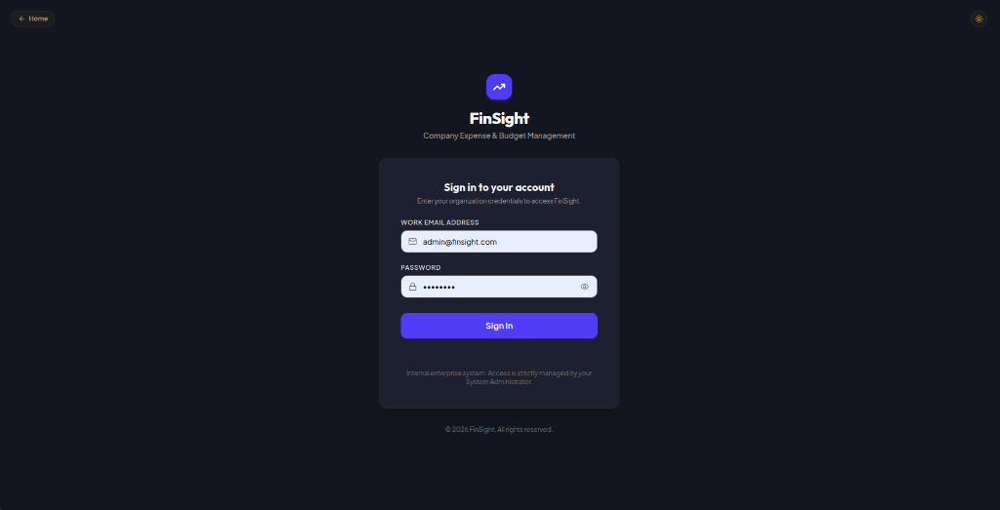
</p>

- Enterprise User Directory and Lifecycle Governance:

<p align="center">
  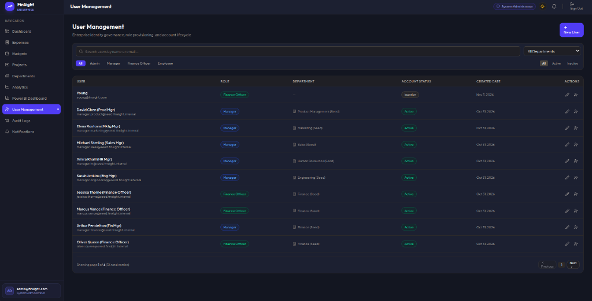
</p>

### 2. Multi-File Expense Submission & Cloudinary Receipts
- Drag-and-drop receipt upload supporting `.png`, `.jpg`, `.jpeg`, and `.pdf` up to 5MB.
- Secure direct streaming to Cloudinary with metadata capture (`file_name`, `file_path`, `content_type`, `file_size_bytes`).
- Form validations preventing empty descriptions or non-positive amounts.

<p align="center">
  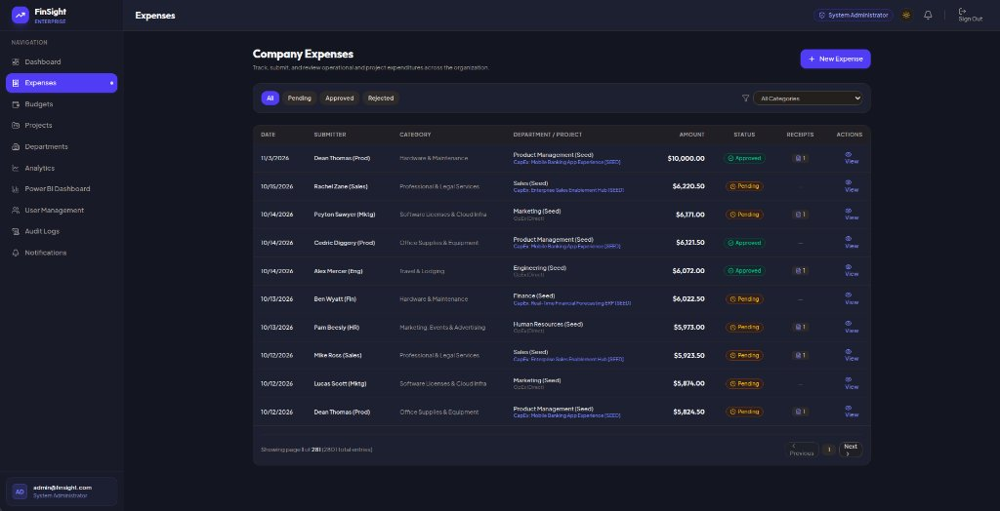
</p>

<p align="center">
  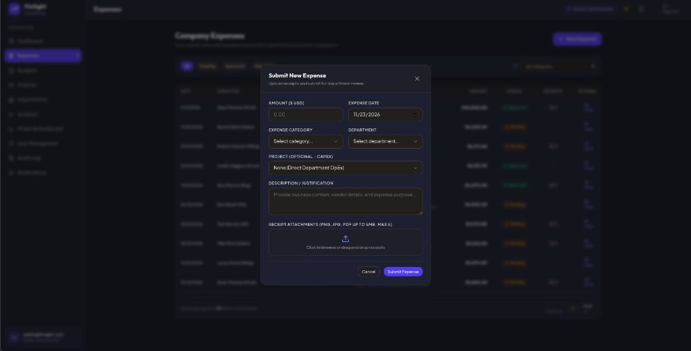
</p>

### 3. Department Adjudication & Optimistic Review Workflow
- Managers view and adjudicate claims submitted exclusively by members of their department.
- One-click Approve and Reject decisions. Rejections enforce a mandatory written comment.
- Optimistic database locking (`status = 'pending'`) within atomic SQL transactions to eliminate double-review race conditions.

<p align="center">
  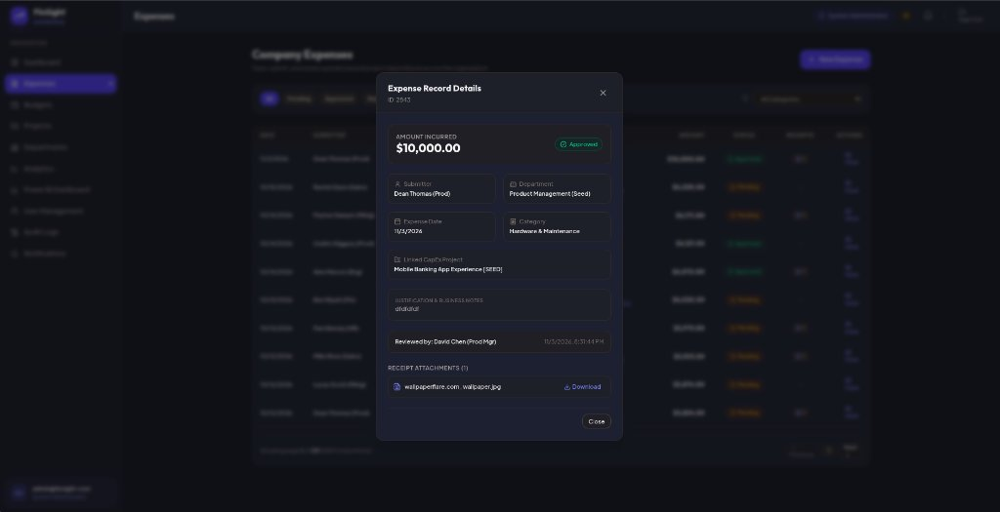
</p>

### 4. Dual-Stream Budget Governance & Project Portfolios
- Finance officers allocate, update, and manage departmental OpEx and project CapEx budgets.
- Live tracking of allocated vs spend, remaining balance, utilization percentage, and budget overrun flags (`is_overrun`).

<p align="center">
  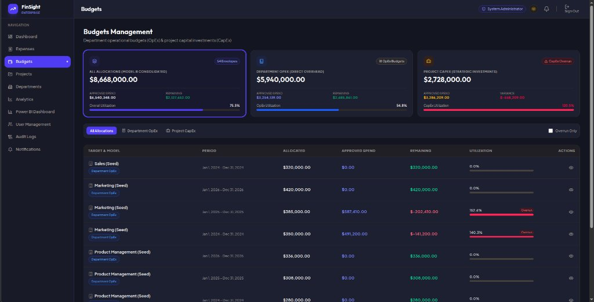
</p>

- Strategic Capital Projects Management (CapEx):

<p align="center">
  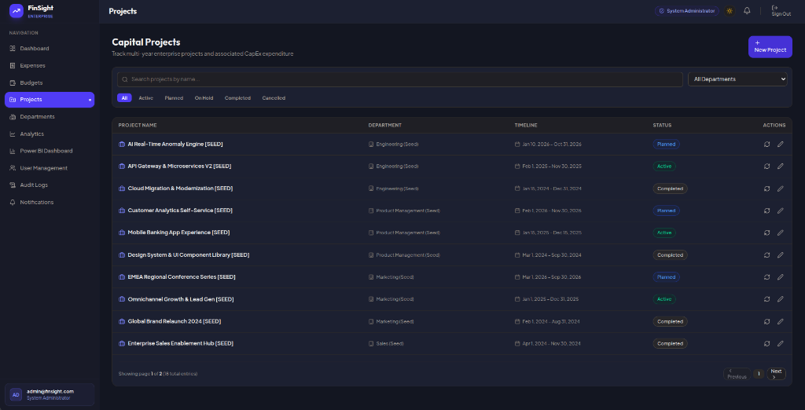
</p>

<p align="center">
  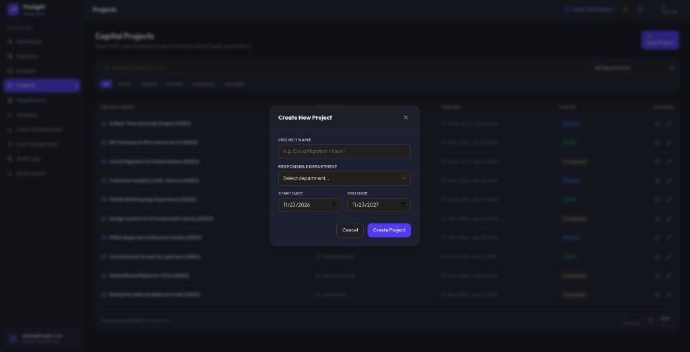
</p>

### 5. Native Recharts Analytics Dashboard
- Responsive interactive visualizations: Monthly Spend Velocity trends, Categorical Pie Distributions, Department Comparisons, and Project Realizations.
- Dynamic filtering by Date Range, Department, Category, and Project.

<p align="center">
  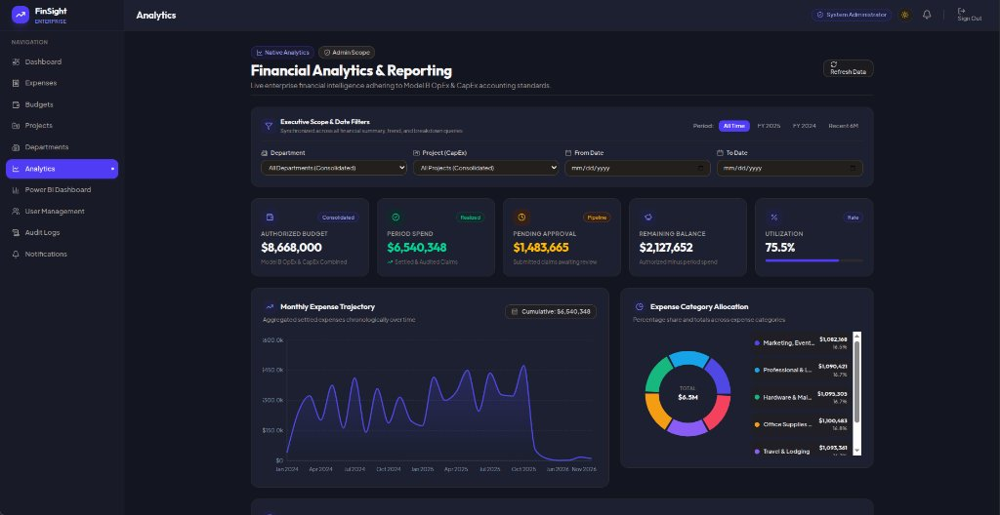
</p>

<p align="center">
  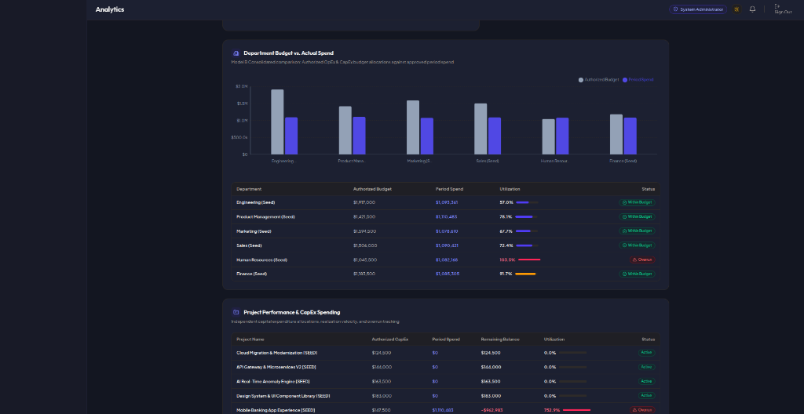
</p>

### 6. Live Microsoft Power BI Embedded Workspace
- Dedicated `/power-bi` portal featuring the FinSight Power BI Dashboard.
- Responsive container with proportional `1140 / 541.25` aspect ratio containment, progressive min-height clamping, iframe reloading, and HTML5 Fullscreen API integration.
- Powered by Azure Active Directory organizational authentication (`autoAuth=true`), ensuring enterprise data confidentiality.

<p align="center">
  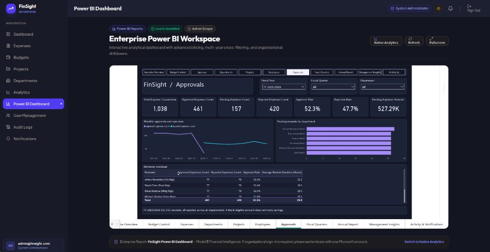
</p>

### 7. Modern FinTech Design System & Global Dark/Light Theme
- Styled according to Concept C: Modern Editorial FinTech with Outfit and Plus Jakarta Sans typography.
- Native Dark Mode and Light Mode toggling via Tailwind CSS v4, synchronized across document roots and persisted in storage.
- Full Internationalization (i18n) with dynamic Directionality (LTR / RTL) supporting English (`en`) and Arabic (`ar`).

### 8. Enterprise Non-Repudiation Audit Trail & Notifications
- Every critical state transition (claim submission, approval, rejection, budget allocation, user updates) generates an immutable `activity_logs` entry.
- Real-time in-app notification drawer alerting submitters upon claim review decisions.

<p align="center">
  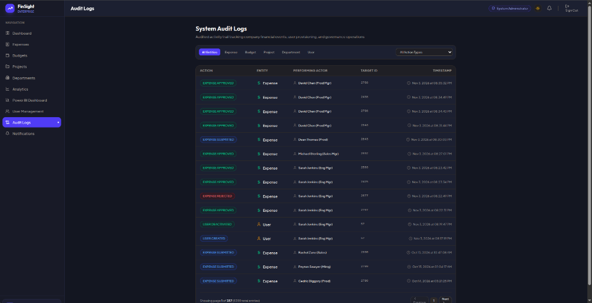
</p>

---

## Role-Based Access Matrix

| Feature / Workspace | Route | System Admin | Finance Officer | Department Manager | Employee |
|---|---|:---:|:---:|:---:|:---:|
| Public Landing Page | `/` | Yes | Yes | Yes | Yes |
| Role Dashboard | `/dashboard` | Yes (Enterprise) | Yes (Financial) | Yes (Dept Scope) | Yes (Personal) |
| Expense Submission | `/expenses` (Modal) | Yes | Yes | Yes | Yes |
| Personal Expense History | `/expenses` | Yes (All) | Yes (All) | Yes (Dept Scope) | Yes (Self Only) |
| Manager Approvals Queue | `/approvals` | No | No | Yes (Dept Scope) | No |
| Budget Management & Creation | `/budgets` | Yes (View) | Yes (Create/Edit) | Yes (Dept View) | No |
| Project Management | `/projects` | Yes (Full) | Yes (View) | Yes (View) | Yes (View) |
| Department Management | `/departments` | Yes (Full) | Yes (View) | Yes (View) | Yes (View) |
| User Directory Governance | `/users` | Yes (Full CRUD) | No | No | No |
| System Audit Logs | `/activity-logs` | Yes (Global) | Yes (Financial) | Yes (Dept Scope) | No |
| Native Analytics Suite | `/analytics` | Yes (Global) | Yes (Global) | Yes (Dept Scope) | Yes (Personal) |
| Power BI Workspace | `/power-bi` | Yes | Yes | Yes | No |

---

## Demo Personas & Pre-Seeded Credentials

For evaluation and demonstration, the database comes pre-seeded with the following credentials:

| Role | Name | Email | Password | Scope / Department |
|---|---|---|---|---|
| System Admin | Admin | `admin@finsight.com` | `admin123` | Global Enterprise Governance |
| Finance Officer | Marcus Vance | `marcus.vance@seed.finsight.internal` | `Password123!` | Enterprise Financial & Budgets |
| Dept Manager | Sarah Jenkins | `manager.engineering@seed.finsight.internal` | `Password123!` | Engineering Department |
| Employee | Alex Chen | `emp.eng.1@seed.finsight.internal` | `Password123!` | Engineering Department Submitter |

---

## Technology Stack & Architecture

```
fin-sight/
├── docs/                        # Project documentation & visual assets
│   └── screenshots/             # Enterprise UI workflow screenshots
├── src/                         # Backend (NestJS 11 + TypeORM)
│   ├── auth/                    # JWT issuance, single-flight rotation, guards
│   ├── system-admin/            # Super-admin management
│   ├── users/                   # User profiles & directory
│   ├── departments/             # Department OpEx scopes & managers
│   ├── projects/                # Project CapEx scopes
│   ├── budgets/                 # Model B budget allocations & summary engine
│   ├── expenses/                # Claim submission, categories, Cloudinary storage
│   ├── approvals/               # Manager review workflow & optimistic locking
│   ├── analytics/               # Native analytics aggregation & reporting DTOs
│   ├── activity-logs/           # Non-repudiation audit logging
│   ├── notifications/           # User status notifications
│   ├── common/                  # Exception filters, interceptors, pipes, enums
│   └── database/                # Seeding pipelines & generators
├── frontend/                    # Frontend (React 19 + TypeScript + Vite + Tailwind v4)
│   ├── src/app/                 # Layouts (Sidebar, Topbar), Router, Providers
│   ├── src/features/            # Domain modules (expenses, budgets, analytics, power-bi, etc.)
│   ├── src/components/ui/       # Design System UI components (Button, Card, Badge, Modal, Input)
│   ├── src/services/api/        # Axios API client with single-flight refresh queue
│   └── src/i18n/                # Localization dictionaries (English & Arabic RTL)
└── test/                        # Quality Assurance & Testing Suites
    ├── final-phase/             # Integration tests (01 to 10), load test, benchmarks
    └── test-powerbi-embed.ts    # Playwright automated Power BI test suite
```

### Backend Architecture
- Framework: NestJS 11 (Node.js 22 LTS)
- Database / ORM: PostgreSQL 16 via TypeORM
- Security & Auth: Passport JWT, Stateless Access Tokens (7d), In-Database Refresh Token Rotation, Bcrypt (10 rounds)
- Validation & Pipeline: `I18nValidationPipe`, `class-validator`, `class-transformer`
- File Storage: Cloudinary SDK streaming (`cloudinary`)
- Exception Interception: `CustomExceptionFilter` mapping domain exceptions without leaking stack traces

### Frontend Architecture
- Framework: React 19 + Vite 8
- Language: TypeScript 5.8 (Strict mode with `verbatimModuleSyntax`)
- Styling: Tailwind CSS v4 with `@tailwindcss/vite`
- Server State: TanStack Query v5 (React Query)
- HTTP Client: Axios with centralized request/response interceptors and request deduplication
- Charts & BI: Recharts + Power BI Embedded iframe container
- Icons: Lucide React

---

## Getting Started & Local Installation

### Prerequisites
- Node.js: `v22.x` or higher
- Package Manager: `pnpm` (`v9.x` or `v10.x`)
- Docker & Docker Compose: For running PostgreSQL

---

### Step 1: Clone the Repository
```bash
git clone https://github.com/your-username/fin-sight.git
cd fin-sight
```

---

### Step 2: Configure Environment Variables

Create `.env` in the root project directory:

```env
# Application Port & Environment
port=4000
node_env="development"
fallbackLanguage="en"

# PostgreSQL Database Connection
host=localhost
db_port=5432
username=postgres
password=postgres123
name=finsight_db

# System Administrator Defaults
systemAdminName="Admin"
systemAdminEmail="admin@finsight.com"
systemAdminPassword="admin123"

# JWT Authentication Secrets
jwtSecret="your-secure-jwt-secret-key-change-in-production"
accessTokenExpireIn="7d"
refreshTokenExpireIn="15d"

# Cloudinary Storage Configuration
cloudinaryCloudName="your-cloudinary-cloud-name"
cloudinaryApiKey="your-cloudinary-api-key"
cloudinaryApiSecret="your-cloudinary-api-secret"
```

Configure Frontend `.env` in `frontend/.env`:
```env
VITE_API_BASE_URL="http://localhost:4000/api/v1"
VITE_POWER_BI_EMBED_URL="https://app.powerbi.com/reportEmbed?reportId=809f893e-e567-4844-aa24-10971c2c07dc&autoAuth=true&ctid=27a388d0-1a33-462f-a48b-52c5342daf56"
VITE_POWER_BI_REPORT_ID="809f893e-e567-4844-aa24-10971c2c07dc"
```

---

### Step 3: Install Dependencies
```bash
# Install root & backend dependencies
pnpm install

# Install frontend dependencies
cd frontend && pnpm install && cd ..
```

---

### Step 4: Start PostgreSQL with Docker
```bash
pnpm run docker:up
```
To verify the database container is running: `docker ps | grep finsight_postgres`

---

### Step 5: Seed Baseline Financial Data
Populate `finsight_db` with enterprise departments, projects, users, Model B budgets, and 2,800+ audited expenses:
```bash
pnpm run seed
```

---

### Step 6: Start Development Servers

In terminal 1 (Backend API - Port 4000):
```bash
pnpm run start:dev
```

In terminal 2 (Frontend Client - Port 5173):
```bash
cd frontend
pnpm run dev
```

Open your browser at `http://localhost:5173`.

---

## Testing, Quality Assurance & Hardening

FinSight has undergone exhaustive testing covering data integrity, performance, concurrency, security, and load scalability:

| Test Suite | Framework / Tool | Scope | Result | Evidence / Artifact |
|---|---|---|:---:|---|
| Financial System Integrity | Jest + Supertest | 319 unit, regression, & invariant assertions | 319 / 319 Passed | `test/final-phase/01-10` |
| Real Browser E2E | Playwright + Chrome | 10 end-to-end multi-role user journeys | 10 / 10 Passed | 6 captured screenshots |
| HTTP API Load Testing | Grafana k6 | 5 profiles up to 150 VUs (24,695 requests) | 0.00% Error Rate | `test/final-phase/k6-load-test.js` |
| Million-Record Benchmark | PostgreSQL + TypeORM | 1,000,000 synthetic rows inserted in 39s | $0.00 Delta | 6 EXPLAIN ANALYZE queries |
| Power BI Iframe Embed | Playwright + Chrome | Multi-viewport responsiveness & SSO check | 7 / 7 Passed | `test/test-powerbi-embed.ts` |
| Static Code & Types | `tsc` + `oxlint` | Production build & linting | 0 Errors | `dist/` bundle verified |

### Running the Test Suites

```bash
# 1. Run Unit & Financial Regression Tests
pnpm run test

# 2. Run Comprehensive Financial Hardening Phase (01 to 10)
npx ts-node -T test/final-phase/run-all-final-phase.ts

# 3. Run Playwright End-to-End Browser Journey Suite
npx ts-node -T test/final-phase/e2e-browser-test.ts

# 4. Run Power BI Embed & Responsive Viewport Tests
npx ts-node -T test/test-powerbi-embed.ts

# 5. Run Frontend Production Build & Linting
cd frontend && pnpm build && pnpm lint
```

---

## Core REST API Endpoints

All endpoints are prefixed with `/api/v1` and return standardized `{ data: ..., meta: ... }` JSON structures:

### Authentication (`/auth`)
- `POST /auth/login` — Authenticate user and issue access & refresh tokens.
- `POST /auth/refresh-token` — Single-flight rotation of expired access tokens.
- `POST /auth/logout` — Terminate session and invalidate refresh token.

### Budgets (`/budgets`)
- `GET /budgets/summary` — Consolidated Model B metrics (OpEx vs CapEx vs Total).
- `GET /budgets` — Paginated list of authorized budgets with department/project filters.
- `POST /budgets` — Create new operational or project capital allocation (Finance Officer).
- `PATCH /budgets/:id` — Update budget allocation limits (Finance Officer).

### Expenses (`/expenses`)
- `GET /expenses` — Role-scoped list of claims with category, date, and status filters.
- `GET /expenses/:id` — Retrieve full claim details with receipts.
- `POST /expenses` — Submit multipart claim with Cloudinary receipt attachments.
- `GET /expenses/:id/attachments/:att_id` — Download verified receipt attachment.

### Approvals (`/approvals`)
- `GET /approvals/pending` — Department manager's pending adjudication queue.
- `PATCH /approvals/expenses/:id/review` — Approve or reject claim with mandatory comment.

### Analytics (`/analytics`)
- `GET /analytics/summary` — High-level KPI metrics (Total Budget, Approved Spend, Pending, Utilization).
- `GET /analytics/monthly-trend` — Monthly spending velocity time series.
- `GET /analytics/category-breakdown` — Categorical distribution and share.
- `GET /analytics/department-comparison` — Cross-departmental variance analysis.
- `GET /analytics/project-performance` — Project capital expenditure realization.

### Governance (`/users`, `/departments`, `/projects`, `/activity-logs`)
- `GET /users` — Enterprise user directory (Admin).
- `GET /departments` — Organizational departments directory.
- `GET /projects` — Corporate project initiatives directory.
- `GET /activity-logs` — Non-repudiation audit trail logs.

---

## Security Best Practices

1. SQL Injection Immune: 100% of queries use TypeORM QueryBuilder with strict parameterized bindings (`:deptId`, `:uid`) or FindOptionsWhere objects. Zero raw string interpolations.
2. Cross-Site Scripting (XSS): React JSX auto-escaping across all views. Zero usage of `dangerouslySetInnerHTML`.
3. CSRF Resilient: Uses bearer tokens via `Authorization` headers rather than ambient cookies; immune to classic browser cross-site request forgery.
4. Token Hygiene: Access tokens kept strictly in JS memory; refresh tokens in `sessionStorage` (cleared on tab close).
5. Information Leakage Prevention: Production errors are intercepted by `CustomExceptionFilter`, returning standardized generic error responses without database stack traces.

---

## License & Attribution

This project is licensed under the [MIT License](LICENSE).

Developed with enterprise standards for modern fintech accounting, automated approval governance, and executive financial intelligence.
